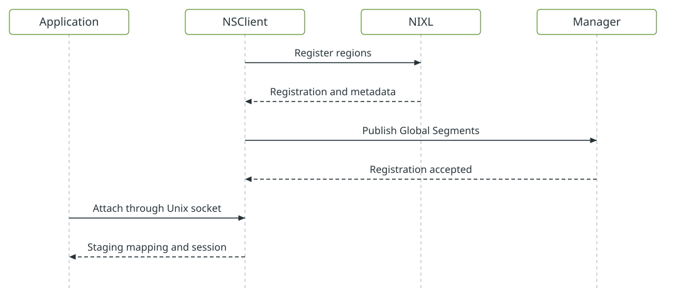
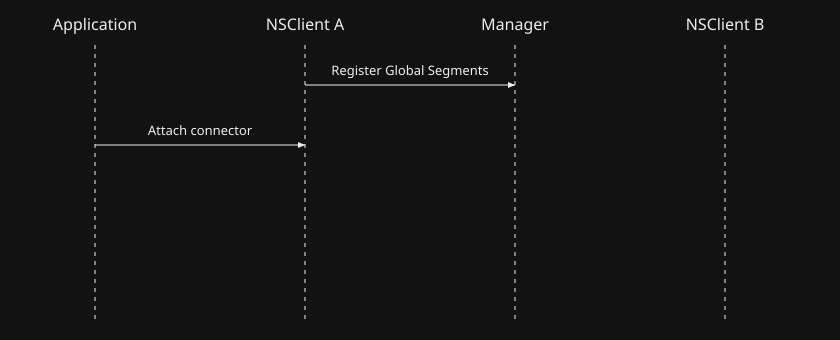
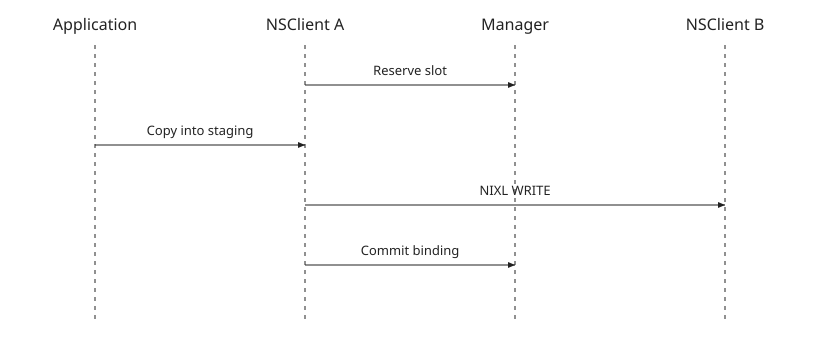
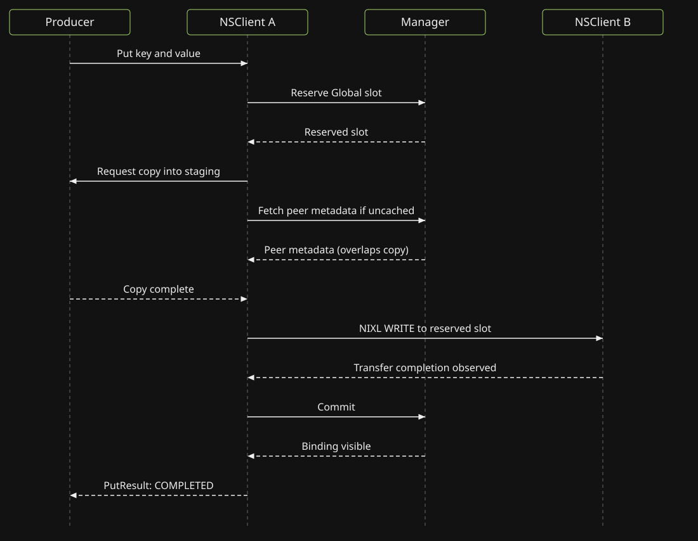
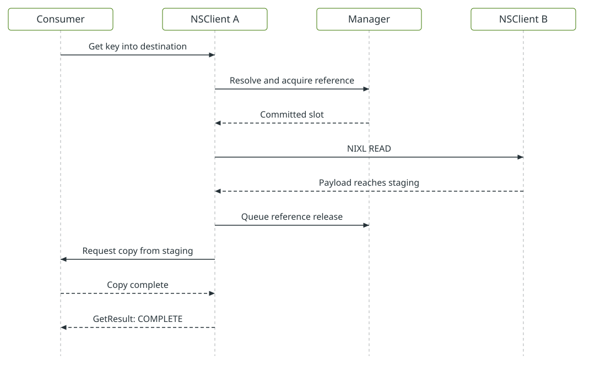
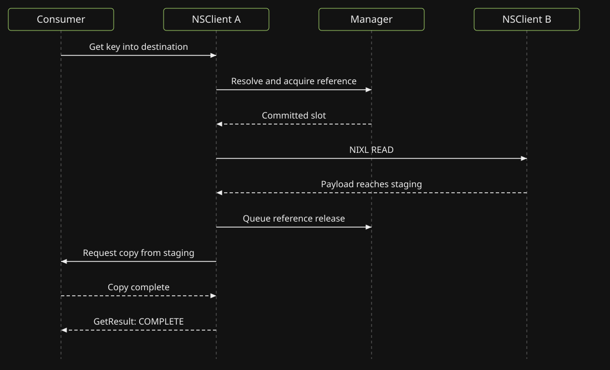
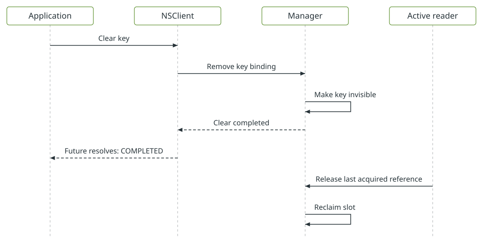
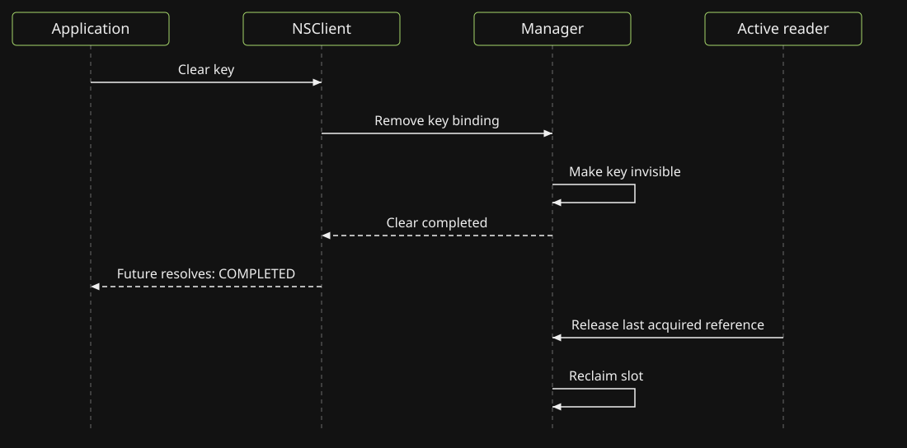
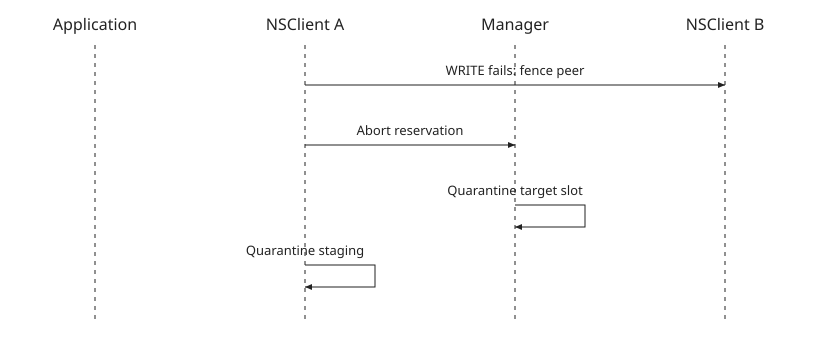
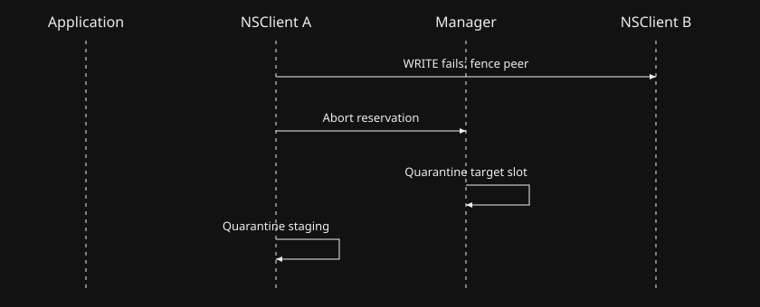

## Design Overview

1. **Manager** - The central metadata authority owns key bindings, slot states, reference counts, the peer catalog and Global Segment allocation.
2. **NSClient** - A per-node process owns registered memory, its NIXL agent and transfer progress. An embedded NSClient is planned for a future version.
3. **NSConnector** - The library inside each application reaches the NSClient over a Unix socket. Python exposes it as `nixl_store`.

Run one NSClient on each participating node and attach each application to its local process. Run the Manager separately. Global Segments use Manager-coordinated placement and reference tracking. Local Segments let the NSClient allocate capacity and resolve locally hosted objects while coordinating their shared lifecycle with the Manager. A namespace is fixed when you create a connector and scopes the keys used by that connection.

The Manager decides where objects live and when readers can see them. NSClients move payload bytes directly through NIXL. No payload passes through the Manager. NIXL Store provides no separate transport: it uses NIXL registration, connection metadata and transfers. See [NIXL Architecture](/nixl/getting-started/architecture) for the underlying agent model.

## Memory Pool

A **region** is a contiguous range of NSClient memory registered with NIXL as one unit, with its own epoch. In NIXL Store, a **segment** is a unit of store capacity backed by one registered region - not a NIXL memory segment. A **slot** is one allocation inside a segment.

**Staging** is a region with no segment. It is shared with connectors and is never published to peers. A **Local Segment** holds objects in capacity allocated by its owning NSClient. A **Global Segment** holds objects in capacity allocated by the Manager. Both segment types use CPU DRAM. Local allocation and Global allocation share the same visibility and reclamation contract.

| Memory | Allocation | Holds key bindings | Manager visibility |
| --- | --- | --- | --- |
| Staging | NSClient staging pool | No | Not published as a segment |
| Local Segment | Owning NSClient allocator | Yes | Registered in the catalog; allocation owned by the NSClient |
| Global Segment | Manager allocator | Yes | Registered in the catalog |

Allocators are pluggable per segment. Fixed size-class allocation suits object sizes known in advance; buddy allocation supports dynamically sized objects. Different segments can use different allocators. Staging uses configured slot classes, while segment configuration defines capacity, object-size bounds and alignment. Adding storage does not fix a value that cannot fit staging. In the staged transfer path, every value must fit a staging slot, regardless of the Global Segment capacity. An oversized value returns `VALUE_TOO_LARGE`. Staging contention can instead require waiting for a suitable slot.

A transfer writes a reserved slot, not an already visible object's storage. Failed writes therefore cannot publish partial replacements. Uncertain transfers require quarantine rather than immediate buffer reuse.

<Note>
The NSClient registers regions at startup. Individual operations reuse that registration rather than registering each application's buffers as store capacity.
</Note>

## Manager

The Manager binds namespace/key pairs to slots, tracks their states and references, and allocates capacity from registered Global Segments. It owns neither the physical memory nor payload bytes. Placement policies rank eligible segments:

- **Local-first** - Prefer placement on the requesting node, with randomized choices within each tier. This is the default.
- **Free-ratio** - Prefer segments with a higher reported free-capacity ratio to balance free space across segments.
- **Random** - Select randomly among eligible segments.

NSClients publish connection metadata and region metadata through the Manager. Another NSClient fetches peer metadata lazily when it needs a transfer destination or source. Epoch checks distinguish registrations so cached information is not accepted for a different region lifetime. This path does not require an application-managed etcd service; compare [Metadata Exchange with etcd](/nixl/user-guide/metadata-exchange-with-etcd).

An unavailable Manager prevents reliable metadata progress. An already posted NIXL transfer can have its own completion, but that does not establish a committed write or release a reference. Applications must inspect operation results rather than infer store success from network activity. A Manager restart loses its in-memory bindings; the store does not provide persistent recovery or Manager high availability.

## NSClient and NSConnector

The NSClient attaches applications through a Unix socket with same-user admission and maps staging into their processes. The NSConnector owns application-side submission and copy work, not authoritative metadata. In the initial standalone deployment, the NSConnector reaches the Manager through the NSClient and does not own a NIXL agent.

Python writes and reads accept these copy selections. See [Bindings](/nixl/developer-guide/nixl-store#bindings) for signatures and buffer requirements.

| Copy selection | Behavior |
| --- | --- |
| `copy=None` | Use the registered function for the device pair, or the built-in copy |
| `copy=function` | Use that function for this call, bypassing registration |

Copy functions run on the connector's copy worker and complete before the operation proceeds. A failed copy can leave the read destination partially modified. See [Bindings](/nixl/developer-guide/nixl-store#bindings) for callback lifetime and reentry rules.

<Info>
Your framework orders producers and consumers. NIXL Store does not schedule application work or notify a consumer that a producer is ready. A key becomes available through the store's commit contract.
</Info>

## Data Flow: Two-Node Example

Node A runs an application that produces and consumes objects. Node B provides storage. Both run an NSClient and share a Manager. The following phases show initialization, write, read, clear and failure handling. Solid arrows show requests; dashed arrows show results or observed NIXL transfer completion. Transfer completion arrows represent the initiating agent observing completion, not an application-level reply from the storage process. Solid arrows show requests; dashed arrows show results or observed NIXL transfer completion. Transfer completion arrows represent the initiating agent observing completion, not an application-level reply from the storage process. Storage placement is the Manager's decision; the diagrams show an object stored on node B.

<Info>
Initialize services and attachments once. Repeat put, get and clear for each application lifecycle. A new connector does not need a private NIXL registration.
</Info>

### Initialization

<div className="diagram-light sequence-diagram">
<Frame caption="Phase 1: Initialization">

</Frame>
</div>
<div className="diagram-dark sequence-diagram">
<Frame caption="Phase 1: Initialization">

</Frame>
</div>

Start the Manager, then each NSClient. The NSClient creates and registers its regions with NIXL before publishing its Global Segments to the Manager. Publishing first would advertise memory before usable transfer metadata exists. Connection metadata and region metadata describe the storage regions; staging is excluded. Finally, attach the application's connector to its local socket and map the offered staging memory.


### Put

<div className="diagram-light sequence-diagram">
<Frame caption="Phase 2: Put">

</Frame>
</div>
<div className="diagram-dark sequence-diagram">
<Frame caption="Phase 2: Put">

</Frame>
</div>

For a Global placement, the Manager reserves a slot before the NSClient offers staging to the producer's connector. The connector then copies the value into staging. This copy can overlap the lookup of peer metadata needed for the transfer. Once both are ready, the NSClient performs a NIXL WRITE to the reserved slot. Only a successful transfer followed by commit makes the binding visible. The blocking write returns a status and an optional placement descriptor; check the status before treating publication as successful.

Put rejects an existing binding with `PUT_REJECT`. Upsert reserves new storage and atomically replaces the binding at commit. Readers already holding the previous slot can finish before it is reclaimed. A failed WRITE does not publish the new slot and enters the failure path below.

```
put(key, value)
upsert(key, replacement)
```

### Get

<div className="diagram-light sequence-diagram">
<Frame caption="Phase 3: Get">

</Frame>
</div>
<div className="diagram-dark sequence-diagram">
<Frame caption="Phase 3: Get">

</Frame>
</div>

The Manager resolves the key and takes a reference to the committed slot. The consumer's NSClient reads it into staging through NIXL. When that transfer completes, it queues release of the stored-object reference and offers staging for the connector's copy. Staging remains protected until that copy finishes; the stored slot need not remain pinned for the application copy.

Once a get acquires a reference to a committed slot, that slot remains allocated until the NIXL read into staging finishes. A concurrent clear removes the key for new readers, but the acquired read can still finish with the old value. An upsert publishes a replacement in a different slot, so existing reads finish with the old value while reads resolved after the commit receive the replacement. After a clear, a new read finds no binding unless another write has recreated the key. Size query is a separate operation, so an intervening replacement can change the required capacity. Inspect destination state: `UNTOUCHED`, `MAY_BE_PARTIAL` or `COMPLETE`. Consume bytes only after a successful, complete result.

```
capacity = size_query(key)
allocate destination with capacity
get(key, destination)
check status, destination_state and bytes_copied
```

### Clear

<div className="diagram-light sequence-diagram">
<Frame caption="Phase 4: Clear">

</Frame>
</div>
<div className="diagram-dark sequence-diagram">
<Frame caption="Phase 4: Clear">

</Frame>
</div>

Clear returns a completion handle. Waiting for successful completion establishes invisibility to new readers, not immediate physical reclamation. Readers that acquired the old binding still finish safely. The Manager reclaims the slot after those references drain.

```
future = clear(key)
status = future.wait()
```

### Failure and Scaling

<div className="diagram-light sequence-diagram">
<Frame caption="Phase 5: Failure and Scaling">

</Frame>
</div>
<div className="diagram-dark sequence-diagram">
<Frame caption="Phase 5: Failure and Scaling">

</Frame>
</div>

A joining NSClient registers its segments with the Manager. Existing peers fetch its metadata lazily.

RPC sessions use heartbeats to detect lost connections. There is no session resume or replay contract. A dead NSClient loses its volatile memory. Automatic dead-peer cleanup is planned to reconcile its catalog entries and outstanding references safely. Application attachment teardown handles local outstanding work, but it does not erase all keys written by that application. Do not treat reconnecting as recovery of prior uncertain operations.

After a failed or abandoned WRITE, the NSClient fences the peer agent and quarantines staging that may still be accessed. The Manager quarantines the target slot. The operation is not retried automatically. Epochs and generations detect stale metadata and slot identities; they do not stop an already issued transfer by themselves. Safe reuse therefore also requires transfer completion or fencing and quarantine.

```
if WRITE fails:
    fence peer agent
    quarantine staging and target slot
    report failure without publishing the key
```
